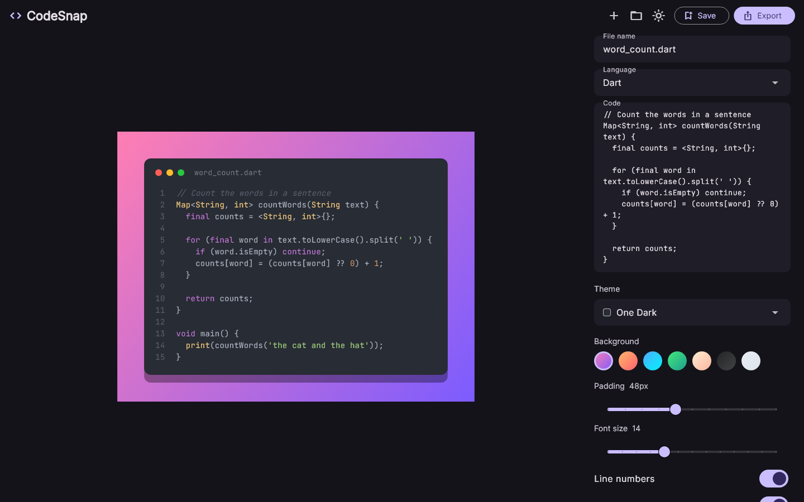
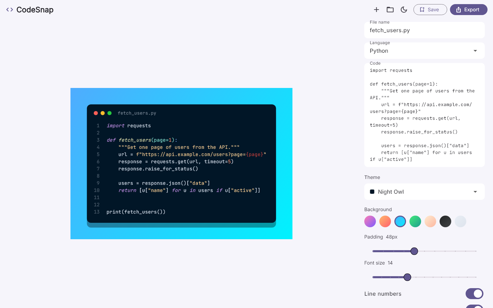
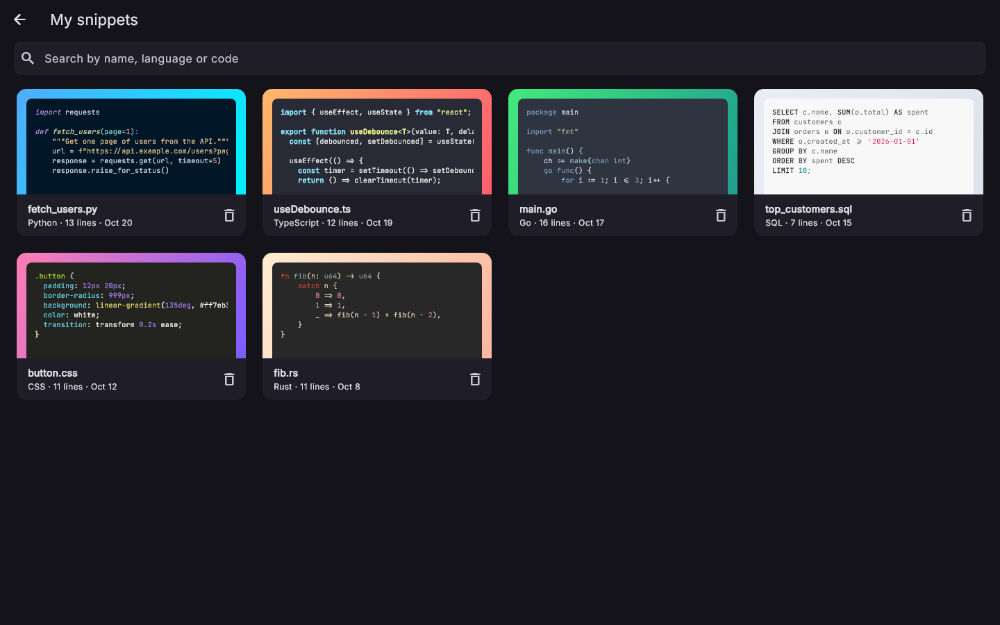
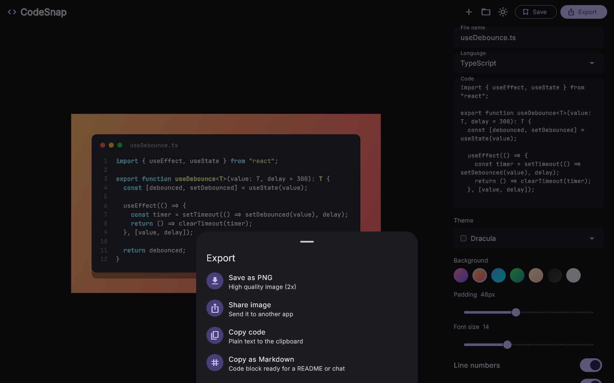
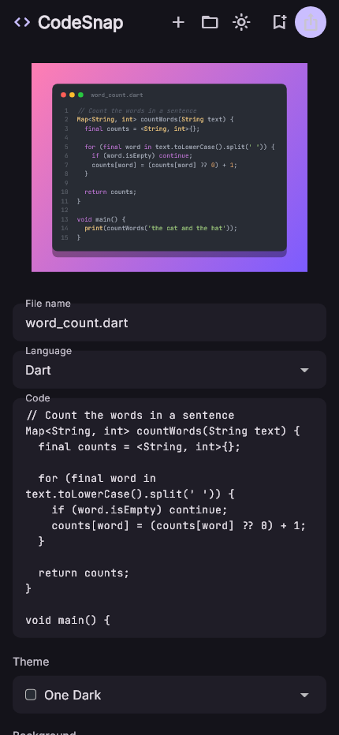

# CodeSnap

Turn code snippets into nice images you can share.

I paste some code, pick a theme and a background, and CodeSnap gives me a clean PNG with syntax highlighting, a little window bar and line numbers. I use it for LinkedIn posts, for my notes and when I want to show a piece of code to a friend without sending a blurry screenshot of my editor.

Built with **Flutter** for **Windows** and **Android**, using **BLoC** and **clean architecture**.

## Screenshots

| Editor (dark) | Editor (light) |
|:---:|:---:|
|  |  |
| **My snippets** | **Export** |
|  |  |

<p align="center">
  <br/>
  <b>Phone layout</b>
</p>

## Why I built it

There are websites that do this, but I wanted something that works offline, remembers my favourite style and keeps the snippets I post often in one place. It was also a good excuse to practice BLoC and clean architecture on a project small enough to finish.

## Features

- **Live preview**: the card updates while you type.
- **Syntax highlighting** for 18 languages (Dart, Python, JavaScript, TypeScript, Go, Rust, SQL, ...).
- **10 code themes**: One Dark, Dracula, Night Owl, Monokai, Nord, Gruvbox, VS Code, One Light, GitHub, Solarized.
- **7 gradient backgrounds**, adjustable padding and font size.
- Toggle **line numbers** and the **window buttons**.
- **Save snippets** to a local library together with their style.
- **Search** the library by name, language or code, and delete with a confirmation.
- **Export**: save as PNG (rendered at 2x so it stays sharp), share the image, copy the code, or copy it as a Markdown code block.
- **Light and dark mode**, remembered between launches.
- Responsive layout: side panel on desktop, single column on phones.

## Architecture

The app is split by feature, and every feature follows the same layers.

```
lib/
├── main.dart                     # loads dependencies, then runs the app
├── app.dart                      # MaterialApp + top level blocs
├── injection_container.dart      # get_it setup
├── core/
│   ├── constants/                # code themes, languages, backgrounds
│   ├── errors/                   # CacheException and Failure
│   └── theme/                    # light and dark app theme
└── features/
    ├── editor/
    │   └── presentation/         # EditorBloc, editor page, code card, style controls
    ├── snippets/
    │   ├── domain/               # Snippet entity, repository contract, usecases
    │   ├── data/                 # SnippetModel (json), local data source, repository impl
    │   └── presentation/         # LibraryBloc, library page, snippet tile
    ├── export/
    │   ├── domain/               # ExportRepository, SaveImage, ShareImage
    │   ├── data/                 # file_selector + share_plus implementation
    │   └── presentation/         # export bottom sheet
    └── settings/
        ├── domain/               # SettingsRepository, Get/SaveDarkMode
        ├── data/                 # shared_preferences implementation
        └── presentation/         # ThemeCubit
```

- **Domain** is plain Dart: entities, abstract repositories and one class per usecase. It doesn't know about Flutter widgets or shared_preferences.
- **Data** implements the repositories. Snippets are saved as a JSON list in `shared_preferences`. The data source throws a `CacheException` and the repository turns it into a `Failure` for the layer above.
- **Presentation** has the blocs and the widgets. Widgets only send events and draw the state.

### How the BLoC flow works

Saving a snippet, for example:

```
EditorPage  --EditorSaveRequested-->  EditorBloc  --call-->  SaveSnippet usecase
                                                                  |
                                                         SnippetRepository
                                                                  |
                                                      SnippetLocalDataSource (prefs)
EditorPage  <--EditorState(status: saved, message)--  EditorBloc
```

The page listens for status changes and shows a SnackBar with the message.

Exporting works the same way. The page renders the card to PNG bytes with a `RepaintBoundary` (that part needs the widget tree), then sends the bytes to the bloc in an `EditorImageExported` event, and the bloc calls the `SaveImage` or `ShareImage` usecase.

## Tech stack

| What | Package |
|---|---|
| State management | [flutter_bloc](https://pub.dev/packages/flutter_bloc), [equatable](https://pub.dev/packages/equatable) |
| Dependency injection | [get_it](https://pub.dev/packages/get_it) |
| Syntax highlighting | [highlight](https://pub.dev/packages/highlight), themes from [flutter_highlight](https://pub.dev/packages/flutter_highlight) |
| Storage | [shared_preferences](https://pub.dev/packages/shared_preferences) |
| Export | [file_selector](https://pub.dev/packages/file_selector), [share_plus](https://pub.dev/packages/share_plus), [path_provider](https://pub.dev/packages/path_provider) |
| Tests | [bloc_test](https://pub.dev/packages/bloc_test), [mocktail](https://pub.dev/packages/mocktail) |
| Fonts | Inter and JetBrains Mono (bundled in `assets/fonts`) |

## Run it

You need Flutter 3.38 or newer.

```bash
git clone https://github.com/sirine2907/CodeSnap.git
cd CodeSnap
flutter pub get

flutter run -d windows     # desktop
flutter run -d android     # phone or emulator
```

To build a release for Windows:

```bash
flutter build windows --release
```

## Tests

```bash
flutter test
```

There are tests for the model, the data source, the repository, all the usecases, both blocs, the theme cubit and a few widgets (code card and library page).

The screenshots in this README come from golden tests in `test/screenshots`. After changing the UI I regenerate them with:

```bash
flutter test test/screenshots --update-goldens
```

## License

MIT, see [LICENSE](LICENSE).
